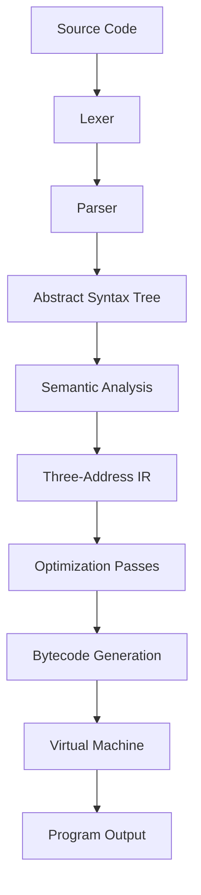

# MiniForge
A C++17 educational compiler featuring lexical analysis, recursive-descent parsing, AST construction, semantic analysis, three-address code IR, optimization passes, bytecode generation, and a custom stack-based virtual machine.
# MiniForge — A C++ Mini Compiler and Virtual Machine

MiniForge is an educational compiler toolkit built in **C++17** that demonstrates how a high-level programming language can be transformed into an intermediate representation, optimized, and executed on a custom stack-based virtual machine.

The project implements a complete compiler pipeline, from lexical analysis and parsing to semantic analysis, intermediate code generation, optimization, bytecode generation, and execution.

## Features

- **Lexical Analysis:** Hand-written lexer with source location tracking and error reporting.
- **Parsing:** Recursive-descent parser with operator precedence and abstract syntax tree (AST) construction.
- **Semantic Analysis:** Scoped symbol tables, declaration checks, and variable scope validation.
- **Intermediate Representation:** Structured three-address code (3AC) with temporary variables and control-flow labels.
- **Compiler Optimizations:** Constant folding, constant propagation, and dead temporary assignment elimination.
- **Bytecode Generation:** Translation from intermediate representation into custom stack-machine instructions.
- **Virtual Machine:** Executes generated bytecode with runtime error handling and optional execution tracing.
- **Command-Line Interface:** Inspect tokens, ASTs, intermediate code, bytecode, and program execution.
- **Automated Testing:** Unit and end-to-end tests for compiler stages and runtime behavior.
- **Continuous Integration:** GitHub Actions workflow for automated builds and tests.

## Compiler Pipeline



## Example

MiniForge supports variable declarations, arithmetic expressions, conditionals, loops, and printing.

### Source program

```text
let x = 4;
let y = 3;
let result = x + y * 2;

if (result > 8) {
    print(result);
} else {
    print(0);
}
```

Expected output:

```text
10
```

### Intermediate representation

Before optimization:

```text
x = 4
y = 3
t0 = y * 2
t1 = x + t0
result = t1
t2 = (result > 8)
jump_if_zero t2, L_else_0
print result
jump L_end_1
L_else_0:
print 0
L_end_1:
```

After optimization, constant propagation and folding simplify the expression:

```text
x = 4
y = 3
result = 10
jump_if_zero 1, L_else_0
print result
jump L_end_1
L_else_0:
print 0
L_end_1:
```

This illustrates how compile-time evaluation can simplify expressions before bytecode generation.

## Technology Stack

| Component | Technology |
|---|---|
| Programming language | C++17 |
| Build system | CMake |
| Compiler frontend | Hand-written lexer and parser |
| Intermediate representation | Three-address code |
| Optimization | Constant folding, propagation, dead temporary elimination |
| Runtime | Custom stack-based virtual machine |
| Testing | Self-contained C++ test harness |
| CI | GitHub Actions |

## Project Structure

```text
MiniForge/
├── include/
│   ├── lexer/
│   ├── parser/
│   ├── ast/
│   ├── semantic/
│   ├── ir/
│   ├── optimizer/
│   ├── codegen/
│   └── vm/
├── src/
│   ├── lexer/
│   ├── parser/
│   ├── semantic/
│   ├── ir/
│   ├── optimizer/
│   ├── codegen/
│   ├── vm/
│   └── main.cpp
├── tests/
├── examples/
├── docs/
├── .github/workflows/
├── CMakeLists.txt
└── README.md
```

## Getting Started

### Prerequisites

- A C++17-compatible compiler.
- CMake.
- Git.

### Build

Clone the repository:

```bash
git clone https://github.com/JATIN17082005/MiniForge.git
cd MiniForge
```

Create a build directory and compile:

```bash
cmake -S . -B build
cmake --build build --config Release
```

Run the following commands from the project root. The executable path may differ depending on your compiler and build configuration.

### Run a program

```bash
miniforge run examples/basic.mf
```

### Inspect compiler stages

```bash
miniforge tokens examples/basic.mf
miniforge ast examples/basic.mf
miniforge ir examples/basic.mf
miniforge ir examples/basic.mf --no-opt
miniforge bytecode examples/basic.mf
miniforge run examples/basic.mf --trace
```

These commands illustrate the compiler pipeline, including tokenization, parsing, intermediate representation, optimization, bytecode generation, and runtime execution.

Refer to the actual CLI help and README instructions in the repository if executable paths or command syntax differ.

## Testing

Run the project's test suite using the build instructions and commands documented in the repository.

The test suite covers:

- Lexer tokens and lexical errors.
- Parsing, precedence, and syntax errors.
- Semantic analysis and variable scope.
- Intermediate representation generation.
- Optimization passes.
- Bytecode generation and label resolution.
- Virtual machine execution and runtime errors.
- End-to-end programs.

The current development run reported **34 tests passed and 0 failed**. Results may vary after subsequent code changes; rerun the tests before publishing a release.

## Documentation

Additional design notes are available in `docs/`:

- `architecture.md` — compiler architecture and data flow.
- `grammar.md` — language grammar and operator precedence.
- `ir-and-optimization.md` — intermediate representation and optimization passes.
- `virtual-machine.md` — bytecode instructions and VM execution.

## Limitations

MiniForge is an educational compiler and runtime. It does not implement the NVIDIA PTX instruction set, CUDA compilation, native object-file linking, or production-grade register allocation.

Its custom bytecode and virtual machine provide a controlled environment for learning compiler construction and runtime execution.

## Future Improvements

- Add a register-based virtual machine.
- Introduce basic-block construction and control-flow graph analysis.
- Implement liveness analysis and register allocation.
- Add an experimental backend targeting a real instruction set.
- Expand semantic analysis and optimization testing.

## License

Released under the MIT License. See `LICENSE` for details.

---

**Author:** Jatin Poripireddi  
**Focus:** Compiler Design, C++ Systems Programming, Intermediate Representations, and Virtual Machines
