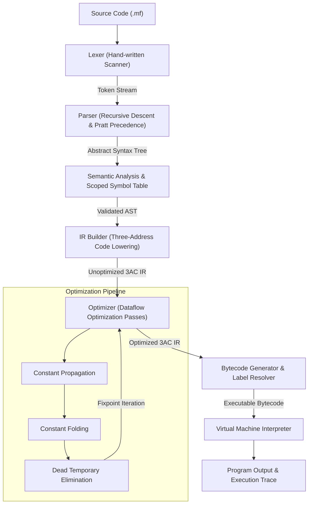

# MiniForge: A C++ Mini Compiler and Optimization Toolkit

[](https://github.com/JATIN17082005/MiniForge/actions/workflows/ci.yml)
[](https://en.wikipedia.org/wiki/C%2B%2B17)
[](LICENSE)

**MiniForge** is an educational, production-style optimizing compiler and virtual machine written from scratch in modern C++17. It translates a structured imperative language into an Abstract Syntax Tree (AST), performs rigorous lexical scoping and semantic analysis, lowers the program to a Three-Address Code (3AC) Intermediate Representation (IR), applies real dataflow optimization passes (Constant Propagation, Constant Folding, and Dead Temporary Elimination), lowers to a custom stack-based bytecode instruction set, and executes on an instrumented virtual machine runtime.

MiniForge was engineered as a portfolio project demonstrating core compiler engineering principles directly applicable to systems software engineering and compiler engineering roles (such as the NVIDIA PTX Compiler System Software Intern application).

---

## 1. Compiler Pipeline Architecture

MiniForge implements an end-to-end multi-stage compiler pipeline with clean separation of concerns and clear modular boundaries:



### End-to-End Transformation Walkthrough

Consider the canonical MiniForge program:
```text
let x = 4;
let y = 3;
let result = x + y * 2;

if (result > 8) {
    print(result);
} else {
    print(0);
}
```

1. **Tokens**: Scanned into classified tokens with line and column metadata.
2. **AST**: Operator precedence ensures `y * 2` is nested deeper than `x + ...`.
3. **Semantic Analysis**: Verifies `x`, `y`, and `result` are declared, prevents duplicate declarations in the same scope, and checks lexical block boundaries.
4. **Three-Address Code (Unoptimized)**:
   ```text
   x = 4
   y = 3
   t0 = y * 2
   t1 = x + t0
   result = t1
   t2 = (result > 8)
   jump_if_zero t2, L_else_0
   print result
   jump L_end_1
   L_else_0:
   print 0
   L_end_1:
   ```
5. **Optimized IR** (after Constant Propagation, Constant Folding, and Dead Temporary Elimination):
   ```text
   x = 4
   y = 3
   result = 10
   jump_if_zero 1, L_else_0
   print result
   jump L_end_1
   L_else_0:
   print 0
   L_end_1:
   ```
6. **Bytecode**: Symbolic labels are resolved into concrete program counter offsets.
7. **Virtual Machine Output**: Prints `10`.

---

## 2. Language Specification & Grammar

MiniForge supports:
- 64-bit signed integer arithmetic: `+`, `-`, `*`, `/`, `%`, and unary `-`.
- Variable declarations (`let x = expr;`) and assignments (`x = expr;`).
- Relational and equality comparisons: `==`, `!=`, `<`, `<=`, `>`, `>=`.
- Conditionals: `if (cond) { ... } else { ... }` and `if (cond) { ... }`.
- Loops: `while (cond) { ... }`.
- Output: `print(expr);`.
- Lexical block scoping `{ ... }` with proper shadowing.
- Single-line comments starting with `//`.

### Formal Grammar (EBNF)

```text
Program        ::= Stmt* EOF
Stmt           ::= VarDeclStmt | AssignStmt | IfStmt | WhileStmt | PrintStmt | BlockStmt
VarDeclStmt    ::= "let" IDENTIFIER "=" Expr ";"
AssignStmt     ::= IDENTIFIER "=" Expr ";"
IfStmt         ::= "if" "(" Expr ")" BlockStmt ( "else" BlockStmt )?
WhileStmt      ::= "while" "(" Expr ")" BlockStmt
PrintStmt      ::= "print" "(" Expr ")" ";"
BlockStmt      ::= "{" Stmt* "}"

Expr           ::= EqualityExpr
EqualityExpr   ::= RelationalExpr ( ( "==" | "!=" ) RelationalExpr )*
RelationalExpr ::= AdditiveExpr ( ( "<" | "<=" | ">" | ">=" ) AdditiveExpr )*
AdditiveExpr   ::= MultiplicativeExpr ( ( "+" | "-" ) MultiplicativeExpr )*
Multiplicative ::= UnaryExpr ( ( "*" | "/" | "%" ) UnaryExpr )*
UnaryExpr      ::= ( "-" ) UnaryExpr | PrimaryExpr
PrimaryExpr    ::= INTEGER | IDENTIFIER | "(" Expr ")"
```

See [docs/grammar.md](docs/grammar.md) for full formal specification, associativity, and precedence tables.

---

## 3. Architecture & Module Responsibilities

| Module | Location | Primary Responsibilities |
|---|---|---|
| **Common** | `include/common/`, `src/common/` | Source locations (`line:col`), diagnostic engine (errors, warnings, notes). |
| **Lexer** | `include/lexer/`, `src/lexer/` | Hand-written lexical scanner, token recognition, comment/whitespace skipping, integer overflow checking. |
| **AST** | `include/ast/`, `src/ast/` | Strongly typed AST node hierarchy, Visitor pattern, structured indentation pretty-printer. |
| **Parser** | `include/parser/`, `src/parser/` | Recursive descent with precedence climbing, syntax error recovery and statement synchronization. |
| **Semantic Analysis** | `include/semantic/`, `src/semantic/` | Lexical block symbol tables, variable declaration validation, scope shadowing, use-before-declaration checks. |
| **IR** | `include/ir/`, `src/ir/` | Three-Address Code data structures (`IROperand`, `IRInstruction`, `IRProgram`), SSA-style temporary and label generation. |
| **Optimizer** | `include/optimizer/`, `src/optimizer/` | Dataflow passes: Constant Propagation, Constant Folding, and Dead Temporary Elimination with fixpoint iteration. |
| **Codegen** | `include/codegen/`, `src/codegen/` | Stack bytecode generation, two-pass symbolic branch resolution, jump bounds validation, and disassembler. |
| **VM** | `include/vm/`, `src/vm/` | Stack-based runtime interpreter, operand stack, variable environment, instruction execution, trace logging, and runtime safety checks. |

See [docs/architecture.md](docs/architecture.md) for detailed component interactions and data flow.

---

## 4. Optimization Passes

MiniForge features modular, separate optimization passes that analyze and transform the 3AC IR:

1. **Constant Propagation (`ConstantPropagator`)**:
   - Tracks known variable and temporary constants forward through straight-line basic blocks.
   - Replaces variable uses with constant literals where safe.
   - Clears known constants at control-flow boundaries (labels and jump targets) to avoid unsafe propagation across loop heads and branches.
   - Invalidates bindings when a variable is reassigned.

2. **Constant Folding (`ConstantFolder`)**:
   - Evaluates arithmetic (`+`, `-`, `*`, `/`, `%`) and comparisons (`==`, `!=`, `<`, `<=`, `>`, `>=`) compile-time when both operands are constants.
   - **Division by Zero Safety**: Preserves expressions like `x / 0` un-folded so that runtime exceptions occur deterministically on the VM.

3. **Dead Temporary Assignment Elimination (`DeadCodeEliminator`)**:
   - Collects all temporary operands referenced across the program.
   - Eliminates intermediate assignment instructions whose destination temporary is never read.
   - Preserves user variables and operations with side-effects (`print`).

### Optimization Demonstration

**Input:**
```text
let a = 10;
let b = 20;
let c = a * 2 + b / 4;
let unused = c * 100;
print(c);
```

**Before Optimization (`miniforge ir examples/optimize_demo.mf --no-opt`):**
```text
  a = 10
  b = 20
  t0 = a * 2
  t1 = b / 4
  t2 = t0 + t1
  c = t2
  t3 = c * 100
  unused = t3
  print c
```

**After Optimization (`miniforge ir examples/optimize_demo.mf`):**
```text
  a = 10
  b = 20
  c = 25
  unused = 2500
  print 25
```
*Notice how all intermediate temporaries (`t0`, `t1`, `t2`, `t3`) were folded, propagated, and eliminated!*

See [docs/ir-and-optimization.md](docs/ir-and-optimization.md) for dataflow analysis details.

---

## 5. Virtual Machine & Bytecode Instruction Set

MiniForge compiles to a custom stack-based bytecode.

| Opcode | Operands | Stack Effect | Description |
|---|---|---|---|
| `PUSH_CONST` | `val: int64` | `[] -> [val]` | Push integer constant onto operand stack. |
| `LOAD_VAR` | `name: string` | `[] -> [val]` | Load variable from memory onto stack. |
| `STORE_VAR` | `name: string` | `[val] -> []` | Pop stack and write into variable storage. |
| `ADD` | none | `[a, b] -> [a + b]` | Integer addition. |
| `SUB` | none | `[a, b] -> [a - b]` | Integer subtraction. |
| `MUL` | none | `[a, b] -> [a * b]` | Integer multiplication. |
| `DIV` | none | `[a, b] -> [a / b]` | Integer division (checks for divide-by-zero). |
| `MOD` | none | `[a, b] -> [a % b]` | Integer modulo (checks for modulo-by-zero). |
| `NEG` | none | `[a] -> [-a]` | Arithmetic unary negation. |
| `EQ`, `NEQ` | none | `[a, b] -> [bool]` | Equality / inequality comparison (`1` or `0`). |
| `LT`, `LE` | none | `[a, b] -> [bool]` | Less than / less-than-or-equal. |
| `GT`, `GE` | none | `[a, b] -> [bool]` | Greater than / greater-than-or-equal. |
| `JUMP` | `addr: int64` | `[] -> []` | Unconditional jump: sets `pc = addr`. |
| `JUMP_IF_ZERO`| `addr: int64` | `[cond] -> []` | Conditional jump: if `cond == 0`, sets `pc = addr`. |
| `PRINT` | none | `[val] -> []` | Pop value and print to stdout followed by newline. |
| `HALT` | none | `[] -> []` | Stop execution. |

See [docs/virtual-machine.md](docs/virtual-machine.md) for memory layout and runtime error specifications.

---

## 6. Build Instructions

### Prerequisites
- C++17 compliant compiler (`clang++` >= 11, `g++` >= 9, or MSVC >= 2019)
- CMake >= 3.15
- Build system: Ninja, GNU Make, or MinGW Makefiles

### Building on Windows

```powershell
# Configure with CMake
cmake -S . -B build -G "MinGW Makefiles" -DCMAKE_BUILD_TYPE=Release

# Build executable and test suite
cmake --build build

# Run test suite
.\build\miniforge_tests.exe
```

### Building on Linux / macOS

```bash
# Configure with CMake
cmake -S . -B build -DCMAKE_BUILD_TYPE=Release

# Build
cmake --build build -j$(nproc)

# Run test suite
./build/miniforge_tests
```

---

## 7. Command-Line Interface (CLI)

The compiled binary `miniforge` provides comprehensive inspection options across every stage of the pipeline:

### 1. Run a Program
```bash
miniforge run examples/basic.mf
# Output:
# 10
```

### 2. Inspect Tokens
```bash
miniforge tokens examples/basic.mf
# Output:
# [2:1] LET 'let'
# [2:5] IDENTIFIER 'x'
# [2:7] = '='
# [2:9] INTEGER_LITERAL '4' (val=4)
# ...
```

### 3. Inspect Abstract Syntax Tree (AST)
```bash
miniforge ast examples/basic.mf
# Output:
# Program (4 top-level statements)
#   VarDeclStmt: x [2:1]
#     IntegerLiteral: 4 [2:9]
#   VarDeclStmt: y [3:1]
#     IntegerLiteral: 3 [3:9]
# ...
```

### 4. Inspect Intermediate Representation (IR)
```bash
# Print optimized IR (default)
miniforge ir examples/basic.mf

# Print unoptimized IR
miniforge ir examples/basic.mf --no-opt
```

### 5. Inspect Bytecode Disassembly
```bash
miniforge bytecode examples/basic.mf
# Output:
# 0000  PUSH_CONST      4
# 0001  STORE_VAR       x
# 0002  PUSH_CONST      3
# 0003  STORE_VAR       y
# ...
```

### 6. Step-by-Step Execution Trace
```bash
miniforge run examples/basic.mf --trace
# Output:
# TRACE [0000] 0000  PUSH_CONST      4          | Stack: []
# TRACE [0001] 0001  STORE_VAR       x          | Stack: [4]
# TRACE [0002] 0002  PUSH_CONST      3          | Stack: []
# TRACE [0003] 0003  STORE_VAR       y          | Stack: [3]
# TRACE [0004] 0004  PUSH_CONST      10         | Stack: []
# TRACE [0005] 0005  STORE_VAR       result     | Stack: [10]
# ...
# 10
```

---

## 8. Relevance to Systems Software & Compiler Engineering

This project directly demonstrates engineering competence in foundational compiler concepts discussed in systems software and compiler backend interviews:

1. **Frontend Architecture & Error Recovery**:
   - Hand-written lexer and recursive-descent parser with Pratt precedence climbing.
   - Diagnostic engine with line and column reporting.
   - Panic-mode synchronization preventing cascading errors.

2. **Scoped Symbol Resolution & Semantic Analysis**:
   - Lexical block hierarchy with variable shadowing and use-before-declaration enforcement.
   - Alpha conversion (variable name mangling by lexical scope depth) ensuring correctness across nested scopes.

3. **Intermediate Representations (IR)**:
   - Structured Three-Address Code with explicit operands (`Constant`, `Variable`, `Temporary`).
   - Clean abstraction separating high-level language semantics from target execution details.

4. **Dataflow Optimizations**:
   - Sound local constant propagation and folding within basic blocks.
   - Safe handling of control-flow boundaries (invalidating constant environments at labels and jumps).
   - Liveness-based dead temporary elimination.

5. **Code Generation & Virtual Machine Runtime**:
   - Lowering 3AC to a stack machine.
   - Two-pass branch resolution converting symbolic labels to target instruction offsets.
   - Robust VM runtime handling stack underflow, uninitialized variables, and division by zero.

*(Note: MiniForge is a dedicated educational compiler targeting a custom stack VM. It does not implement native machine code, CUDA compilation, NVIDIA PTX, or GPU register allocation, which represent future extensions.)*

---

## 9. Testing & Quality Assurance

MiniForge includes a comprehensive unit and end-to-end test suite (`tests/`):
- **Lexer Tests**: Token types, comments, multi-character operators, whitespace, invalid characters, integer overflow.
- **Parser Tests**: Operator precedence, parentheses, nested blocks, conditionals, loops, syntax error recovery.
- **Semantic Tests**: Scope resolution, shadowing, duplicate declarations, undeclared variables.
- **IR Generation Tests**: Three-address code generation, temporary IDs, branch labels.
- **Optimizer Tests**: Constant folding, constant propagation, dead code elimination, division-by-zero preservation.
- **Codegen & Disassembler Tests**: Bytecode emission, label resolution, disassembly formatting.
- **VM Tests**: Arithmetic, comparisons, control flow, runtime error detection (underflow, division by zero, uninitialized memory).
- **End-to-End Tests**: Full compilation and execution of complete programs (arithmetic, while-loop summation, factorial, scope shadowing).

```powershell
.\build\miniforge_tests.exe
# Output:
# ========================================
#  Running 34 test suites / cases
# ========================================
#  Test Summary: 34 passed, 0 failed out of 34
# ========================================
```

---

## 10. Project Structure

```text
MiniForge/
├── CMakeLists.txt
├── README.md
├── LICENSE
├── .gitignore
├── include/
│   ├── common/         # SourceLocation, DiagnosticEngine
│   ├── lexer/          # Token, Lexer
│   ├── ast/            # AST hierarchy, ASTVisitor
│   ├── parser/         # Parser
│   ├── semantic/       # SymbolTable, SemanticAnalyzer
│   ├── ir/             # IROperand, IRInstruction, IRProgram, IRBuilder
│   ├── optimizer/      # ConstantFolder, ConstantPropagator, DeadCodeEliminator, Optimizer
│   ├── codegen/        # Bytecode, CodeGenerator, Disassembler
│   └── vm/             # VirtualMachine
├── src/
│   ├── common/
│   ├── lexer/
│   ├── ast/
│   ├── parser/
│   ├── semantic/
│   ├── ir/
│   ├── optimizer/
│   ├── codegen/
│   ├── vm/
│   └── main.cpp        # CLI entry point
├── examples/           # Sample MiniForge programs (.mf)
├── tests/              # Test suite (34 test cases)
├── docs/               # Detailed architectural and technical documentation
└── .github/
    └── workflows/
        └── ci.yml      # Multi-platform GitHub Actions CI
```

---

## 11. License

This project is licensed under the MIT License — see the [LICENSE](LICENSE) file for details.

---

**Author:** Jatin Poripireddi  
**Focus:** Compiler Design, C++ Systems Programming, Intermediate Representations, and Virtual Machines
