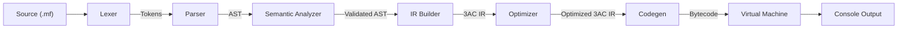

# MiniForge Architecture & Pipeline Design

This document details the architectural design, component boundaries, data flow, and error-handling strategies in the MiniForge compiler.

---

## 1. High-Level Data Flow

The compiler operates as a linear transformation pipeline where each stage takes a well-defined input representation and lowers it to the next abstraction level:

---

## 2. Component Boundaries & Responsibilities

### 2.1 Lexical Analyzer (`miniforge::Lexer`)
- **Input**: `std::string source`
- **Output**: `std::vector<Token>` ending with `TokenType::EndOfFile`
- **Design**:
  - Hand-written deterministic scanner.
  - Maintains `line_`, `column_`, and `current_` offsets.
  - Skips whitespace and single-line comments (`// ... \n`).
  - Converts integer literal strings to `int64_t` using `std::stoll` with range checks.
  - Dispatches lexical diagnostics to `DiagnosticEngine` without throwing exceptions, returning `TokenType::Invalid` to allow subsequent scanning where possible.

### 2.2 Parser & AST (`miniforge::Parser`, `miniforge::ASTNode`)
- **Input**: Token stream
- **Output**: `std::unique_ptr<Program>`
- **Design**:
  - Recursive descent statement parsing coupled with precedence climbing for binary expressions.
  - Strongly typed, polymorphic node hierarchy inheriting from `ASTNode`.
  - Double dispatch Visitor pattern (`ASTVisitor`) separating node definitions from semantic inspection and IR lowering.
  - **Syntax Error Recovery**: Panic-mode error recovery (`synchronize()`) advances the token stream to statement delimiters (`;`, `}`) or keyword anchors (`let`, `if`, `while`, `print`), allowing multi-error discovery in a single compilation run.

### 2.3 Semantic Analyzer (`miniforge::SemanticAnalyzer`)
- **Input**: `Program` AST
- **Output**: Validation boolean; diagnostics emitted to `DiagnosticEngine`
- **Design**:
  - Manages a scoped symbol table (`SymbolTable` and `Scope`).
  - Scopes are organized as a cactus stack (lexical tree) with parent pointers.
  - Validates:
    - Variable existence prior to read / assignment.
    - No duplicate definitions within the identical block scope.
    - Variable shadowing allows inner block declarations to mask outer declarations.
    - Scope exit destroys local variable visibility.

### 2.4 Three-Address Code Builder (`miniforge::IRBuilder`)
- **Input**: Validated `Program` AST
- **Output**: `miniforge::IRProgram`
- **Design**:
  - Flattens the hierarchical AST into linear Three-Address Code (3AC).
  - Explicit operand classes (`IROperand`): `Constant`, `Variable`, and `Temporary`.
  - Temp generator generates fresh numbered temporaries `t0, t1, t2, ...`.
  - Label generator produces symbolic labels `L_loop_start_0`, `L_else_1`, etc.
  - **Scope Alpha Conversion**: Handles shadowed variable names across nested blocks by tracking scope IDs (e.g. `x_1` for an inner `x`), preventing runtime collision in a flat register/variable space.

### 2.5 Optimizer (`miniforge::Optimizer`)
- **Input**: `IRProgram`
- **Output**: Transformed `IRProgram`
- **Design**:
  - Decoupled passes implementing `OptimizationPass` interface:
    - `ConstantPropagator`
    - `ConstantFolder`
    - `DeadCodeEliminator`
  - Driven by an iterative loop running until convergence (no further modifications) or a safety iteration ceiling.
  - Preserves program semantics under all control-flow configurations.

### 2.6 Code Generator (`miniforge::CodeGenerator`)
- **Input**: Optimized `IRProgram`
- **Output**: `miniforge::BytecodeProgram`
- **Design**:
  - Two-pass code generator:
    - **Pass 1**: Converts 3AC operations to stack machine bytecode with symbolic branch targets.
    - **Pass 2**: Resolves symbolic label names into absolute instruction indices (program counter targets).
    - **Pass 3**: Validates jump target boundaries `[0, bytecode.size())`.
  - Appends terminal `HALT` instruction.

### 2.7 Virtual Machine (`miniforge::VirtualMachine`)
- **Input**: `BytecodeProgram`
- **Output**: Console stream / execution exit code
- **Design**:
  - Stack-based evaluation model.
  - Components:
    - Operand stack: `std::vector<int64_t>`
    - Environment store: `std::unordered_map<std::string, int64_t>`
    - Instruction pointer: `size_t pc_`
  - Safety checks:
    - Stack underflow detection before each pop operation.
    - Divide-by-zero and modulo-by-zero detection.
    - Uninitialized variable access detection.
    - Out-of-bounds program counter validation.
  - Real-time execution tracing displaying opcode, operands, and stack contents at each step.

---

## 3. Diagnostic System

MiniForge centralizes diagnostic reporting in `miniforge::DiagnosticEngine`:
- Standardized formatting: `file:line:col: severity: message`.
- Separation of program runtime output from diagnostic errors.
- Clean exit code semantics (0 for success, 1 on any diagnostic error).
