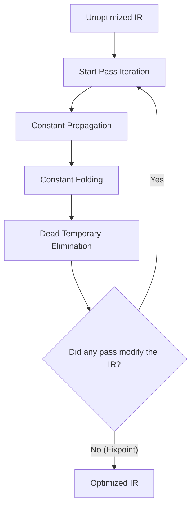

# MiniForge Intermediate Representation & Optimization

This document describes the design of the Three-Address Code (3AC) intermediate representation and the implementation and correctness guarantees of the optimization passes.

---

## 1. Intermediate Representation (3AC)

Three-Address Code (3AC) is an intermediate representation where each instruction has at most one operator and at most three address operands (typically two sources and one destination):
```text
dest = src1 op src2
```

In MiniForge, the IR is not maintained as plain text strings, but as structured, strongly typed C++ objects:

### 1.1 `IROperand`
An operand is an immutable value container with three distinct variants:
1. `Kind::Constant`: Stores a 64-bit integer constant literal (`int64_t`).
2. `Kind::Variable`: Stores a named user-level variable (e.g., `x`, `sum`).
3. `Kind::Temporary`: Stores a compiler-generated temporary variable with a unique integer identifier (e.g., `t0`, `t1`).

### 1.2 `IRInstruction`
Each instruction contains:
- `IROpcode`: `Assign`, `Add`, `Sub`, `Mul`, `Div`, `Mod`, `Neg`, `Equal`, `NotEqual`, `Less`, `LessEqual`, `Greater`, `GreaterEqual`, `Label`, `Jump`, `JumpIfZero`, `JumpIfNotZero`, `Print`.
- `dest`: Destination operand (for assignments, arithmetic, comparisons).
- `src1`, `src2`: Source operands.
- `labelName`: Target label identifier (for labels and branches).

---

## 2. Optimization Passes

MiniForge implements three core dataflow optimizations that interact synergistically.

### 2.1 Constant Propagation (`ConstantPropagator`)

Constant propagation identifies variables and temporaries known to contain compile-time constant values and substitutes their uses with those constant values.

#### Soundness & Control-Flow Safety:
A key challenge in constant propagation is preventing unsafe substitution across control-flow boundaries:
- In a loop, a variable modified in the loop body cannot safely retain its pre-loop initial value at the loop header.
- At branch merge points, a variable may hold different values depending on which branch executed.

MiniForge implements **Basic-Block Local Constant Propagation**:
1. It maintains a map of active constant values: `knownConstants: string -> int64_t`.
2. **Label Boundary**: When encountering any `Label` instruction, a jump could have originated from anywhere in the program. `knownConstants` is immediately cleared.
3. **Jump Boundary**: When encountering any branch (`Jump`, `JumpIfZero`, `JumpIfNotZero`), the straight-line basic block terminates. `knownConstants` is cleared.
4. **Variable Redefinition**: If a variable is assigned a non-constant expression, any existing constant binding for that variable is invalidated and removed from `knownConstants`.

This guarantees that constant propagation is 100% sound and will never propagate stale constants into loop bodies or past conditional joins.

---

### 2.2 Constant Folding (`ConstantFolder`)

Constant folding replaces operations on constant operands with their evaluated result at compile time.

#### Supported Operations:
- Unary negation: `-c1 -> (-c1)`
- Binary arithmetic:
  - `c1 + c2 -> (c1 + c2)`
  - `c1 - c2 -> (c1 - c2)`
  - `c1 * c2 -> (c1 * c2)`
  - `c1 / c2 -> (c1 / c2)` (when `c2 != 0`)
  - `c1 % c2 -> (c1 % c2)` (when `c2 != 0`)
- Comparisons:
  - `c1 == c2 -> 1` or `0`
  - `c1 != c2 -> 1` or `0`
  - `c1 < c2  -> 1` or `0`
  - `c1 <= c2 -> 1` or `0`
  - `c1 > c2  -> 1` or `0`
  - `c1 >= c2 -> 1` or `0`

#### Runtime Error Preservation:
Compiler optimizations must never swallow or silently corrupt program runtime exceptions. If an expression divides or modulos by zero (e.g., `10 / 0`), `ConstantFolder` skips folding and leaves the division instruction intact, ensuring the Virtual Machine triggers a runtime error when executed.

---

### 2.3 Dead Temporary Elimination (`DeadCodeEliminator`)

During IR lowering and constant folding, many intermediate temporaries (`t0`, `t1`, etc.) are created and subsequently replaced with constants. If a temporary is never referenced as a source operand elsewhere in the program, its computation is dead.

1. **Liveness Scanning**: Performs a linear pass over all instructions, collecting every temporary ID read in `src1` or `src2`.
2. **Pruning**: Using `std::remove_if`, removes all instructions whose destination `dest` is a temporary not present in the set of used temporaries.
3. **Safety**: Instructions with side-effects (`Print`, assignments to named user variables) are never eliminated.

---

## 3. Synergy and Fixpoint Iteration

The three passes are scheduled in sequence inside `Optimizer::optimize`:


Because Constant Propagation enables new Constant Folding opportunities, and Constant Folding creates new Dead Temporaries, running the passes iteratively until convergence achieves optimal simplification of expressions without complex inter-pass dependencies.
