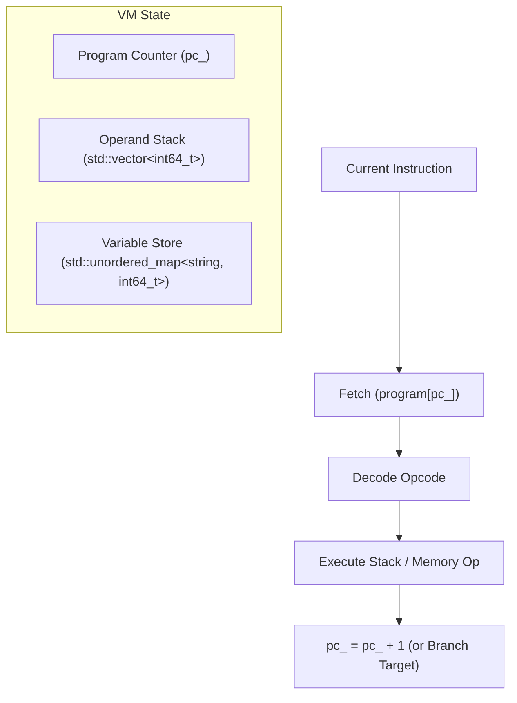

# MiniForge Virtual Machine & Bytecode Specification

This document details the architecture, instruction set, stack semantics, and runtime execution model of the MiniForge Virtual Machine.

---

## 1. Virtual Machine Architecture

The MiniForge VM is an educational stack-based virtual machine designed for simplicity, inspectability, and ease of translation from 3AC IR.



### Components
1. **Program Counter (`pc_`)**: An unsigned index pointing to the currently executing instruction in the instruction array.
2. **Operand Stack (`stack_`)**: A LIFO container of 64-bit signed integers (`int64_t`). All arithmetic, logical comparisons, and condition tests operate exclusively on the top of the stack.
3. **Variable Memory (`memory_`)**: A symbol-to-value map (`std::string -> int64_t`) storing program variables and live temporaries.
4. **Execution Engine (`VirtualMachine::run`)**: Fetches the instruction at `pc_`, advances `pc_`, and executes the corresponding operation.

---

## 2. Instruction Set Reference

All instructions are encoded as `miniforge::VMInstruction` structures containing an 8-bit `Opcode`, an optional 64-bit integer immediate (`intOperand`), and an optional string operand (`strOperand`).

### 2.1 Stack & Memory Operations

#### `PUSH_CONST <int64>`
- **Behavior**: Pushes the integer literal onto the stack.
- **Stack Transition**: `[] -> [val]`

#### `LOAD_VAR <string>`
- **Behavior**: Looks up `<string>` in variable memory and pushes its value onto the stack.
- **Stack Transition**: `[] -> [memory[name]]`
- **Error Condition**: If `<string>` is not found in memory, raises `Access to uninitialized variable '<string>'`.

#### `STORE_VAR <string>`
- **Behavior**: Pops the top value from the stack and stores it in variable memory under `<string>`.
- **Stack Transition**: `[val] -> []`

---

### 2.2 Arithmetic Operations

For all binary arithmetic instructions, the right-hand operand `b` is popped first, followed by the left-hand operand `a`.

#### `ADD`
- **Behavior**: Pops `b`, pops `a`, pushes `a + b`.
- **Stack Transition**: `[a, b] -> [a + b]`

#### `SUB`
- **Behavior**: Pops `b`, pops `a`, pushes `a - b`.
- **Stack Transition**: `[a, b] -> [a - b]`

#### `MUL`
- **Behavior**: Pops `b`, pops `a`, pushes `a * b`.
- **Stack Transition**: `[a, b] -> [a * b]`

#### `DIV`
- **Behavior**: Pops `b`, pops `a`, pushes `a / b`.
- **Stack Transition**: `[a, b] -> [a / b]`
- **Error Condition**: If `b == 0`, raises `Division by zero`.

#### `MOD`
- **Behavior**: Pops `b`, pops `a`, pushes `a % b`.
- **Stack Transition**: `[a, b] -> [a % b]`
- **Error Condition**: If `b == 0`, raises `Modulo by zero`.

#### `NEG`
- **Behavior**: Pops `a`, pushes `-a`.
- **Stack Transition**: `[a] -> [-a]`

---

### 2.3 Comparison Operations

All comparisons push `1` if the condition evaluates to true, or `0` if false.

#### `EQ`: `[a, b] -> [a == b ? 1 : 0]`
#### `NEQ`: `[a, b] -> [a != b ? 1 : 0]`
#### `LT`: `[a, b] -> [a < b ? 1 : 0]`
#### `LE`: `[a, b] -> [a <= b ? 1 : 0]`
#### `GT`: `[a, b] -> [a > b ? 1 : 0]`
#### `GE`: `[a, b] -> [a >= b ? 1 : 0]`

---

### 2.4 Control Flow Operations

#### `JUMP <target_address>`
- **Behavior**: Sets `pc_ = target_address`.
- **Stack Transition**: Unchanged.

#### `JUMP_IF_ZERO <target_address>`
- **Behavior**: Pops `cond` from the stack. If `cond == 0`, sets `pc_ = target_address`; otherwise proceeds to the next instruction.
- **Stack Transition**: `[cond] -> []`

#### `JUMP_IF_NOT_ZERO <target_address>`
- **Behavior**: Pops `cond` from the stack. If `cond != 0`, sets `pc_ = target_address`; otherwise proceeds to the next instruction.
- **Stack Transition**: `[cond] -> []`

#### `HALT`
- **Behavior**: Terminates virtual machine execution cleanly with return code 0.
- **Stack Transition**: Unchanged.

---

### 2.5 I/O Operations

#### `PRINT`
- **Behavior**: Pops `val` from the stack and writes `val` followed by a newline to the output stream.
- **Stack Transition**: `[val] -> []`

---

## 3. Label Resolution

During compilation, branches are generated targeting symbolic label strings (e.g., `L_loop_start_0`, `L_else_1`).

The code generator employs a **Two-Pass Assembler** model:
1. **Pass 1 (Collection)**: Emits instructions to the bytecode buffer. When a `Label` pseudo-instruction is encountered in the IR, its label name is recorded mapped to the current index in the bytecode buffer.
2. **Pass 2 (Resolution)**: Iterates over emitted instructions. For any jump instruction, it looks up the symbolic label in the table and replaces the symbolic target with the concrete absolute integer instruction index.
3. **Pass 3 (Validation)**: Verifies that every target address satisfies `0 <= target < program.size()`.

---

## 4. Execution Tracing (`--trace`)

When running with `--trace`, the VM prints the exact state of the machine before each instruction executes:
```text
TRACE [0000] 0000  PUSH_CONST      4          | Stack: []
TRACE [0001] 0001  STORE_VAR       x          | Stack: [4]
TRACE [0002] 0002  PUSH_CONST      3          | Stack: []
TRACE [0003] 0003  STORE_VAR       y          | Stack: [3]
TRACE [0004] 0004  PUSH_CONST      10         | Stack: []
TRACE [0005] 0005  STORE_VAR       result     | Stack: [10]
TRACE [0006] 0006  PUSH_CONST      1          | Stack: []
TRACE [0007] 0007  JUMP_IF_ZERO    0011       | Stack: [1]
TRACE [0008] 0008  LOAD_VAR        result     | Stack: []
TRACE [0009] 0009  PRINT                      | Stack: [10]
10
TRACE [0010] 0010  JUMP            0013       | Stack: []
TRACE [0013] 0013  HALT                       | Stack: []
```
This tool makes debugging compiler lowering bugs and verifying operand stack balance straightforward and intuitive.
